# IT Support & SLA Management (ServiceNow PDI)

> Hands-on portfolio project built on my ServiceNow Personal Developer Instance
> (Australia release). Not production work.

## Business need
Employees report IT issues, but agents often lack the hardware details needed
to resolve them, critical incidents can sit unacknowledged, and managers have
no clear view of overdue requests.

## My role
Requirements, configuration, scripting, testing, and documentation (solo).

## User stories
1. **As a** service desk agent, **I want** hardware details required for hardware
   issues, **so that** I can resolve them without chasing the caller.
   - *Given* Category is Hardware, *when* the agent fills in the form,
     *then* Affected device and Asset tag are shown and mandatory.
   - *Given* Category is not Hardware, *then* those fields are hidden.
2. **As a** support manager, **I want** P1 incidents escalated if they aren't
   picked up, **so that** critical issues aren't missed.
   - *Given* a P1 incident in New, *when* 30 minutes pass, *then* the group
     manager is emailed and a work note is added.
   - *Given* the incident is moved to In Progress within 30 minutes,
     *then* no escalation is sent.
3. **As a** manager, **I want** a dashboard of SLA breaches, **so that** I can
   see which teams are falling behind.
   - *Given* a P1 incident, *then* a 15-minute response SLA starts automatically.
   - *Given* the incident is not assigned within 15 minutes, *then* the SLA
     breaches and appears on the dashboard under its assignment group.

## Solution
Built on the out-of-box **Incident** table in the Global scope, with all
changes tracked in one update set.

### 1. New fields on Incident
- **Affected device** (choice: Laptop, Desktop, Phone, Printer, Other)
- **Asset tag** (string)

### 2. UI Policy: Hardware details required
- Condition: Category is Hardware
- Makes Affected device and Asset tag visible and mandatory
- "Reverse if false" hides them for other categories

### 3. Client Script: Validate asset tag format
- onChange script on Asset tag
- Checks the value matches `IT-` plus 5 digits, using a regular expression
- Shows an inline error message if the format is wrong

### 4. Business Rule: VIP caller urgency
- Before-insert rule on Incident
- If the caller is marked VIP, sets Urgency to High and adds a work note
- Priority recalculates from Impact × Urgency

### 5. Flow Designer: P1 incident escalation
- Trigger: Incident created with Priority 1 - Critical
- Emails the assignment group, then waits 30 minutes
- Looks up the incident again to get its *current* state; if still New,
  emails the group manager and adds an escalation work note

**Design decision:** The trigger holds a snapshot of the incident from when it
was created, so its State is always New. My first version of the If condition
checked the trigger's State, which would have escalated every P1, even ones
already picked up. I fixed it by adding a Look Up Record step after the wait
and checking that record's State instead.

**Traceability:** The escalation email's header
(`X-ServiceNow-Source: FlowDesigner-5148f7e…`) matches the Sys ID of the
flow execution that generated it, linking the email to the exact flow run.

### 6. SLA definition: P1 Response – 15 min
- Table: Incident · Target: Response · Duration: 15 minutes
- Start: Priority is 1 - Critical · Stop: Assigned to is not empty
- Schedule source: **No schedule**, so the SLA counts 24/7, which is
  appropriate for P1 response

### 7. Reports and dashboard: IT Support – Overdue Overview
- **Breached P1 SLAs by assignment group** (bar chart on the Incident SLA
  database view, filtered to breached SLAs of this definition only)
- **Open incidents by priority** (pie chart, filtered to project test data)
- Built as a Platform Analytics dashboard with descriptions on each chart

## Findings and lessons learned
- **Duplicate of an out-of-box SLA.** After building my P1 response SLA, I found
  the OOB definition "Priority 1 response (15 minutes)" already met the
  requirement; both attached to every P1. In a real implementation I would
  reuse the OOB definition rather than maintain a duplicate. The reports filter
  on my definition so breaches aren't counted twice.
- **SLAs vs. OLAs.** The OOB OLA "Database group resolution (P1 only)" attached
  automatically to P1 incidents assigned to the Database group, showing how an
  internal team agreement (OLA) supports the customer-facing SLA.
- **Priority is derived, not set.** Priority comes from Impact × Urgency via
  the priority lookup rules, which keeps prioritization consistent.
- **Classic reports vs. Platform Analytics dashboards.** A classic report's
  "Add to Dashboard" only lists classic dashboards, so I built the
  visualizations directly in the Platform Analytics dashboard.
- **Update set hygiene.** I reviewed all 27 captured changes. One unrelated
  system record (an OAuth application registry created when I opened Export
  to PDF) was removed from the published XML because it contains credential
  data.

## Configured vs. custom
| Component | Type | Why |
|-----------|------|-----|
| New fields on Incident | Configuration | Standard dictionary fields; upgrade-safe |
| UI Policy | Configuration | No-code; preferred over a Client Script for show/hide/mandatory |
| Client Script | Custom | Format validation needs logic a UI Policy can't do |
| Business Rule | Custom | Server-side logic based on the caller's record; must run regardless of how the incident is created (form, email, API) |
| Flow Designer flow | Extension | Built with low-code platform tools, no scripting; easy for admins to maintain |
| SLA definition | Configuration | Standard SLA engine; no code (and an OOB equivalent already existed) |
| Reports and dashboard | Configuration | Built with platform reporting tools; no code |

## Testing
| Test | Steps | Expected | Result |
|------|-------|----------|--------|
| UI Policy | Set Category to Hardware | Affected device and Asset tag shown and mandatory | Pass |
| Client Script | Enter `12345` in Asset tag | Inline format error shown | Pass |
| Business Rule | Create incident for a VIP caller | Urgency set to High, work note added | Pass |
| Flow: escalation | P1 left in New past the wait (INC0010015) | Manager emailed, escalation work note added | Pass |
| Flow: no escalation | P1 moved to In Progress within 25 seconds (INC0010017) | No escalation email or work note | Pass |
| SLA: met | P1 assigned after 42 seconds (INC0010029) | SLA completed at 4.67% of target | Pass |
| SLA: breached, completed late | P1 assigned after ~40 minutes (INC0010022) | SLA completed at 270%, marked breached | Pass |
| SLA: breached, still open | P1 never assigned (INC0010019) | SLA breached while still in progress | Pass |
| Report accuracy | Compare report to test data | 4 breached P1 SLAs: Service Desk 2, Database 1, Network 1 | Pass |

*Flow tested with a 2–5 minute wait; the final setting is 30 minutes.
Outbound email is disabled on PDIs, so emails were verified in the Outbox.*

## Update set
All work was captured in the **IT Support SLA Portfolio** update set
(Global scope, 27 changes) and exported as XML:
[`it-support-sla-update-set.xml`](it-support-sla-update-set.xml)

It contains the dictionary entries, choice list, form layouts, UI Policy and
actions, Client Script, Business Rule, flow, SLA definition, reports, and
dashboard records.

## Screenshots

### Fields and UI Policy
**Incident form with new hardware fields**

**UI Policy: condition and actions**

**UI Policy test: fields mandatory when Category is Hardware**

### Client Script
**Client Script: settings and code**
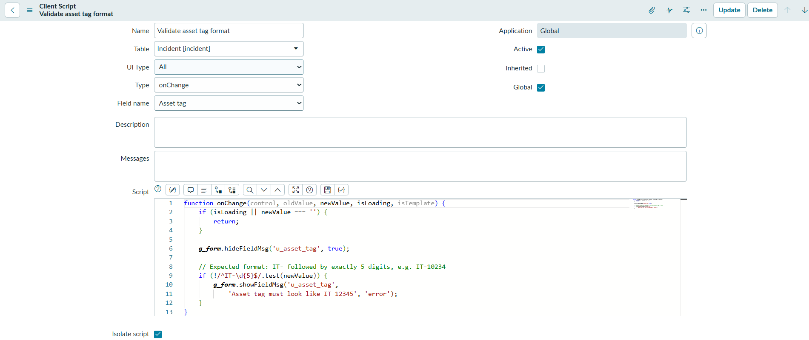

**Client Script test: inline error for an invalid asset tag**
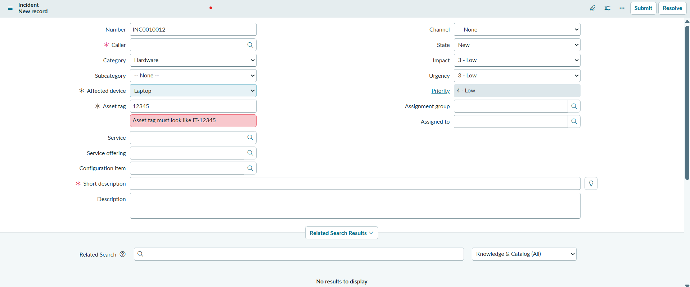

### Business Rule
**Business Rule: when to run**
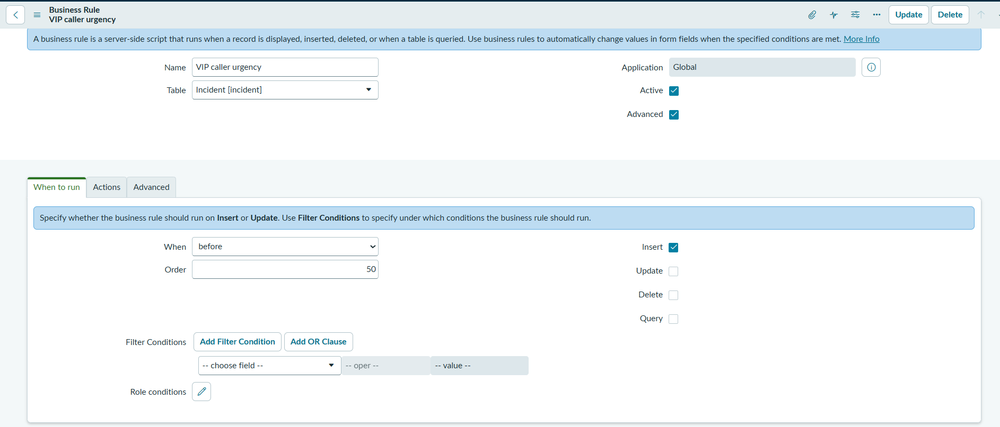

**Business Rule: script**
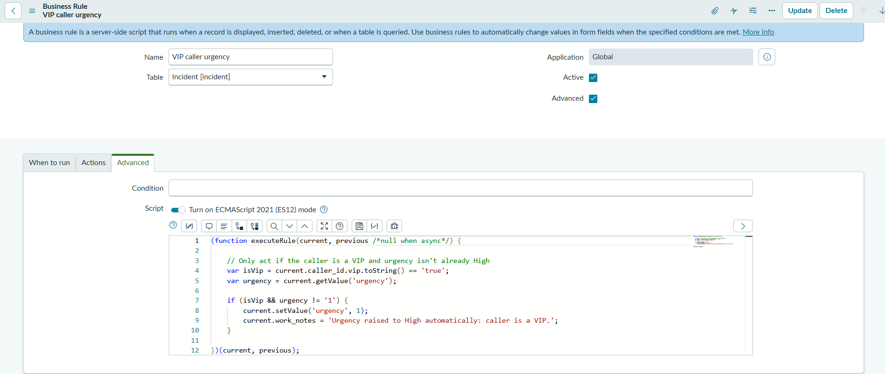

**Business Rule test: VIP incident with Urgency High**
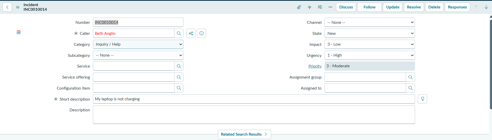

**Business Rule test: automatic work note**
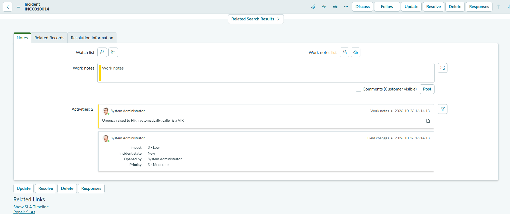

### Flow Designer
**P1 incident escalation flow**
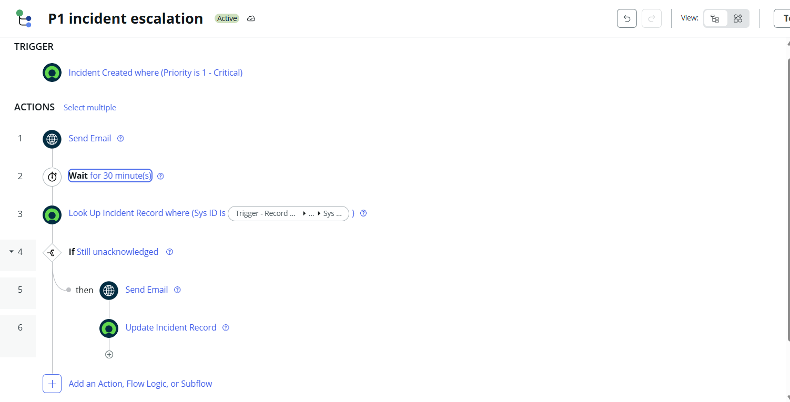

**Flow execution: all steps completed**
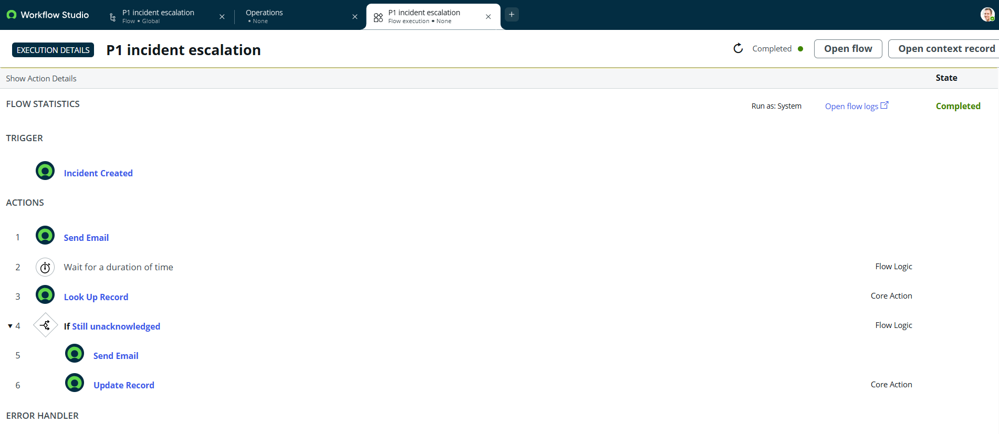

**Test 1, escalated: work note on INC0010015**
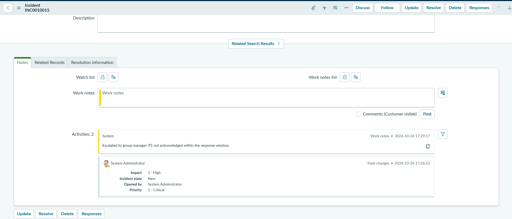

**Test 1, escalated: email to the group manager**
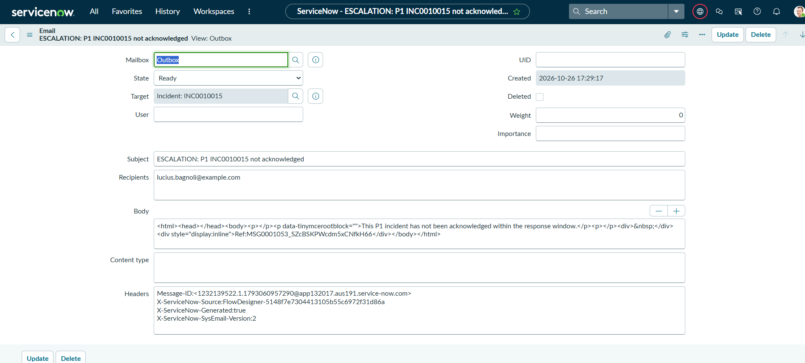

**Test 2, not escalated: INC0010017 acknowledged in 25 seconds**
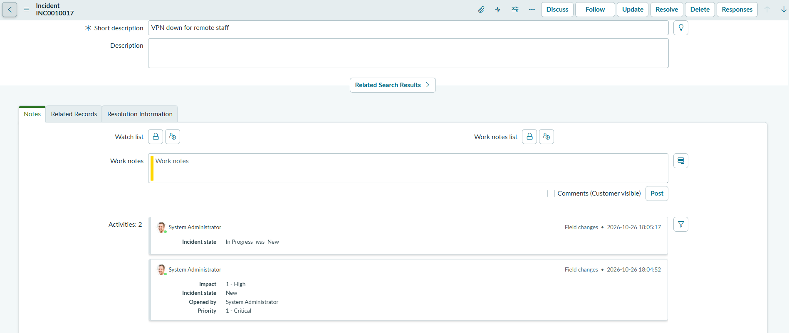

### SLA
**SLA definition: start condition and 24/7 schedule**

**SLA definition: stop condition**

**SLA attached and running on a new P1**

**SLA met: assigned in 42 seconds (4.67%)**

**SLA breached: assigned after ~40 minutes (270%)**

### Reports and dashboard
**Report: breached P1 SLAs by assignment group**

**Report: open incidents by priority**

**Dashboard: IT Support – Overdue Overview**
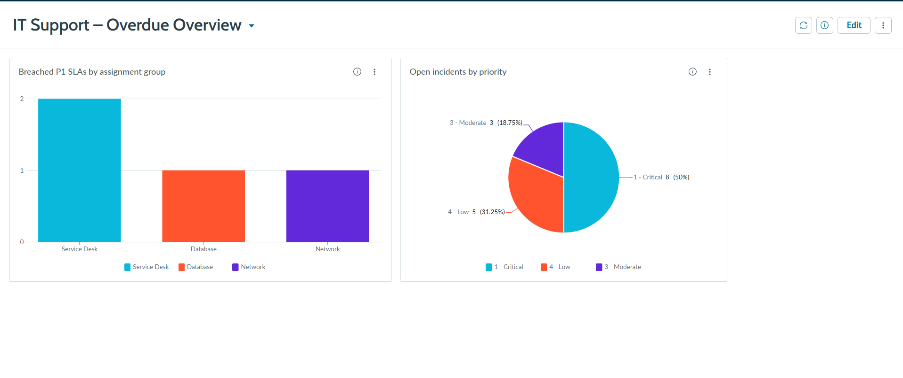

### Update set
**Update set: captured changes**
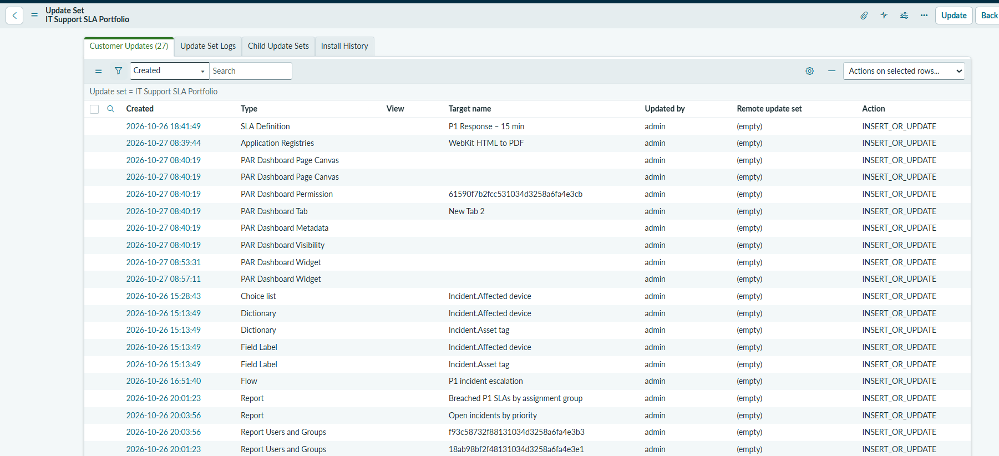

## Results
- Hardware incidents can't be submitted without device details, reducing
  back-and-forth with callers.
- VIP incidents are prioritized automatically, whichever channel they come from.
- Unacknowledged P1 incidents escalate to the group manager after 30 minutes;
  acknowledged ones don't.
- Every P1 gets a 15-minute response SLA, and managers can see breaches by team
  on a single dashboard. In testing it correctly showed 4 breaches across 3 teams.

## What I'd do next
- Reuse the out-of-box P1 response SLA and retire my duplicate.
- Add an onSubmit Client Script or server-side check so an invalid asset tag
  blocks the save, not just warns.
- Add ATF (Automated Test Framework) tests for the UI Policy, Business Rule,
  and flow.
- Add a reminder to the assignment group at 15 minutes, before escalating.
- Add a trend chart of breaches over time once there's more data.
