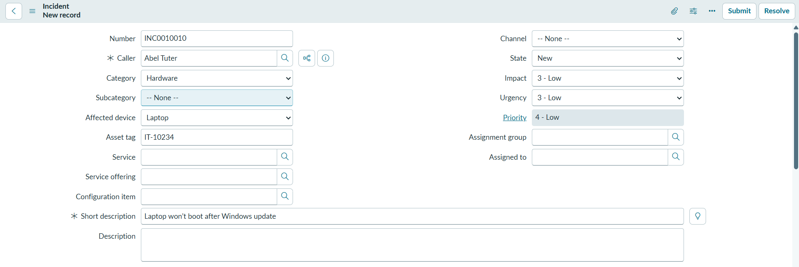
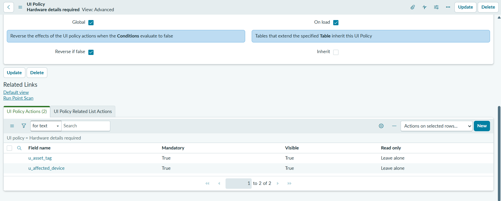
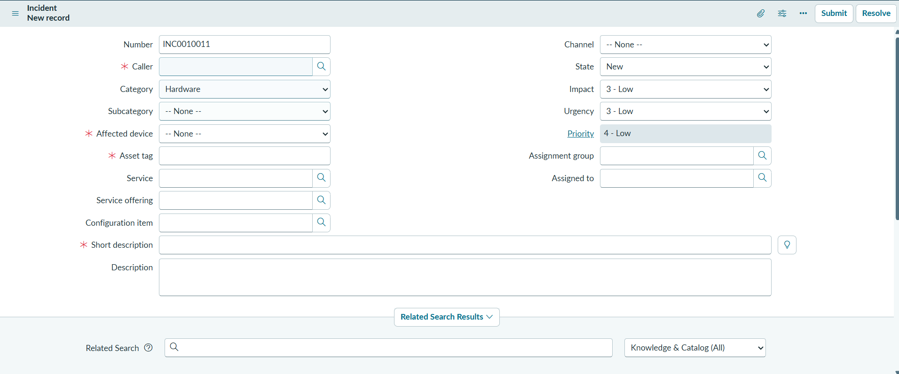

# IT Support & SLA Management (ServiceNow PDI)

> Hands-on portfolio project built on my ServiceNow Personal Developer Instance.
> Not production work.

## Business need
Employees report IT issues, but agents often lack the hardware details needed
to resolve them, critical incidents can sit unacknowledged, and managers have
no clear view of overdue requests.

## My role
Requirements, configuration, scripting, testing, and documentation (solo).

## User stories
1. **As a** service desk agent, **I want** hardware details required for hardware
   issues, **so that** I can resolve them without chasing the caller.
   - *Given* Category is Hardware, *when* the agent fills in the form,
     *then* Affected device and Asset tag are shown and mandatory.
   - *Given* Category is not Hardware, *then* those fields are hidden.
2. **As a** support manager, **I want** P1 incidents escalated if they aren't
   picked up, **so that** critical issues aren't missed. *(in progress)*
3. **As a** manager, **I want** a dashboard of SLA breaches, **so that** I can
   see which teams are falling behind. *(in progress)*

## Solution
Built on the out-of-box **Incident** table in the Global scope, tracked in an
update set.

### 1. New fields on Incident
- **Affected device** (choice: Laptop, Desktop, Phone, Printer, Other)
- **Asset tag** (string)

### 2. UI Policy: Hardware details required
- Condition: Category is Hardware
- Makes Affected device and Asset tag visible and mandatory
- "Reverse if false" hides them for other categories

## Configured vs. custom
| Component | Type | Why |
|-----------|------|-----|
| New fields on Incident | Configuration | Standard dictionary fields; upgrade-safe |
| UI Policy | Configuration | No-code; preferred over a Client Script for show/hide/mandatory |

## Screenshots
**Incident form with new hardware fields**

**UI Policy: condition and actions**

**UI Policy test: fields mandatory when Category is Hardware**

## Results
*(To be completed when the project is finished.)*

## What I'd do next
*(To be completed.)*
