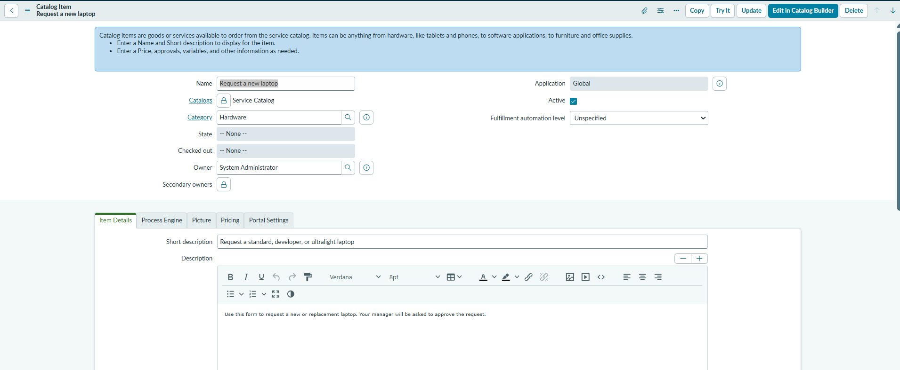
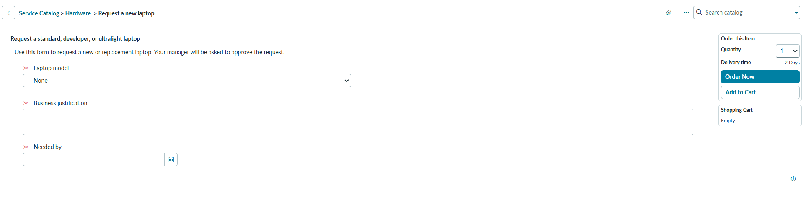
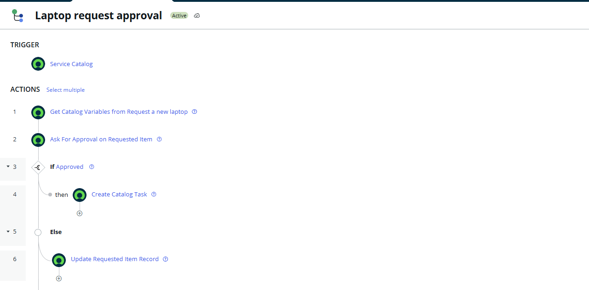
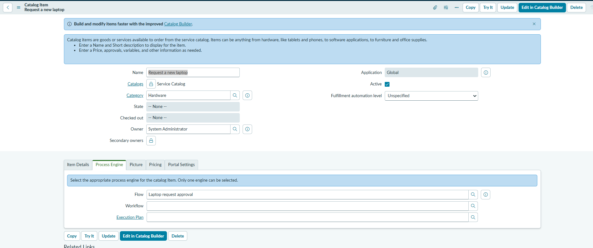
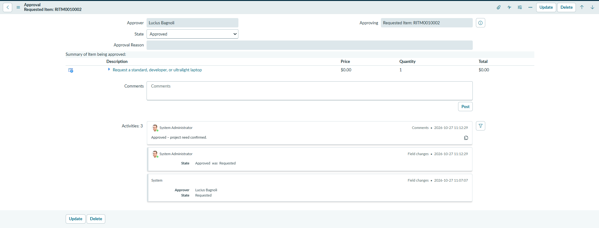
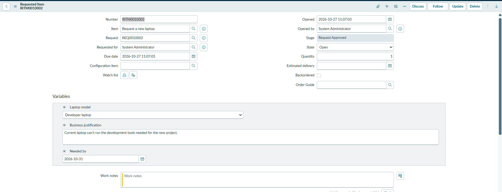
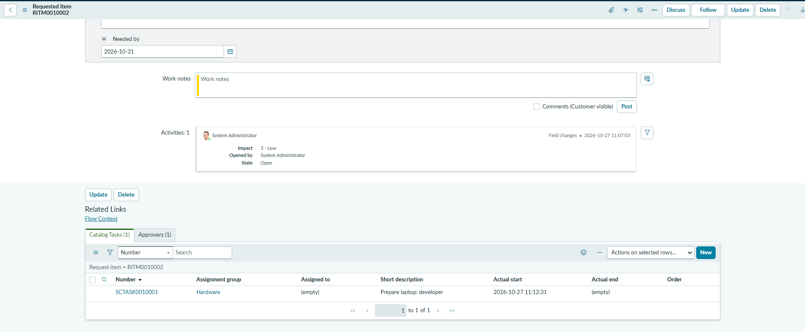
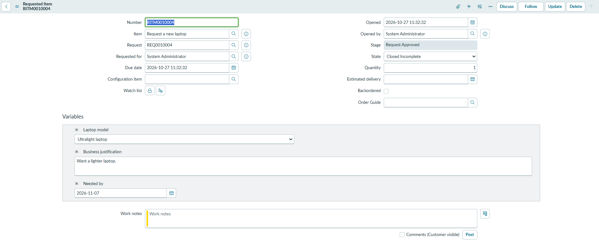
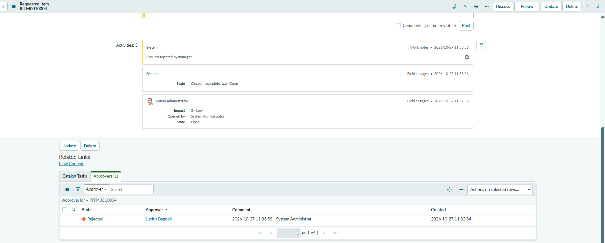
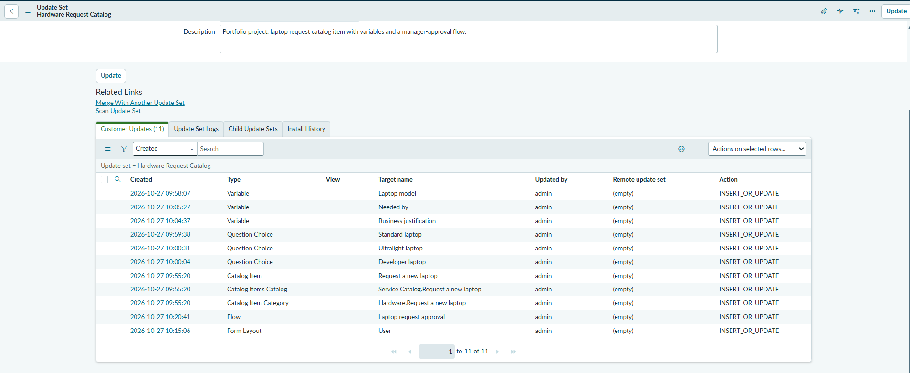

# Hardware Request Catalog Item (ServiceNow PDI)

> Hands-on portfolio project built on my ServiceNow Personal Developer Instance
> (Australia release). Not production work.

## Business need
Employees request laptops by email, so requests lack key details, managers
approve informally, and IT can't tell which requests are approved and ready
to fulfil.

## My role
Requirements, configuration, testing, and documentation (solo).

## User stories
1. **As an** employee, **I want** to request a laptop through the catalog,
   **so that** I don't have to email IT.
   - *Given* I open the item, *then* I must choose a model, give a business
     justification, and pick a needed-by date before I can submit.
2. **As a** manager, **I want** to approve laptop requests from my team,
   **so that** spending is controlled.
   - *Given* an employee submits a request, *then* an approval is sent to the
     manager of the person it's requested for.
3. **As an** IT fulfiller, **I want** a task created only for approved
   requests, **so that** I don't work on unapproved ones.
   - *Given* the manager approves, *then* a catalog task is created for the
     Hardware group.
   - *Given* the manager rejects, *then* no task is created, the request is
     closed as Incomplete, and a work note records the rejection.

## Solution

### 1. Catalog item: Request a new laptop
- Published in the Service Catalog under Hardware
- Variables (all mandatory):
  - **Laptop model:** select box (Standard, Developer, Ultralight), with
    "Include none" so the employee must actively choose
  - **Business justification:** multi-line text
  - **Needed by:** date

### 2. Flow Designer: Laptop request approval
Linked to the item through its Process Engine **Flow** field.
1. **Trigger:** Service Catalog
2. **Get Catalog Variables** from the requested item
3. **Ask For Approval:** the **Requested for** user's manager approves or rejects
4. **If approved:** Create Catalog Task for the Hardware group,
   "Prepare laptop: [model]"
5. **Else:** set the requested item to **Closed Incomplete** and add a work note

**Design decision:** approval goes to the manager of the **Requested for** user,
not the person who submitted the form, so requests made on someone's behalf
still reach the right manager.

## Bug found in testing
My first rejection test (RITM0010003) showed the right branch ran: the approval
was rejected, no task was created, and the work note was added. But the request
closed as **Closed Complete**, not **Closed Incomplete**, so rejected requests
would have looked fulfilled in reporting. I traced it to the wrong State value
in the flow's Update Record step, corrected it, and retested (RITM0010004).

## Configured vs. custom
| Component | Type | Why |
|-----------|------|-----|
| Catalog item and variables | Configuration | Standard Service Catalog features; no code |
| Approval flow | Extension | Built in Flow Designer with out-of-box actions; no scripting |

No custom code was needed for this project.

## Testing
| Test | Steps | Expected | Result |
|------|-------|----------|--------|
| Mandatory fields | Try to submit the form empty | Submission blocked | Pass |
| Approval routing | Order as an employee whose manager is Lucius Bagnoli | Approval created for Lucius Bagnoli | Pass |
| Approved path | Approve RITM0010002 | Catalog task SCTASK0010001 created for Hardware, 2 seconds after approval | Pass |
| Rejected path (first run) | Reject RITM0010003 | Closed Incomplete, no task | **Fail:** closed as Complete |
| Rejected path (after fix) | Reject RITM0010004 | Closed Incomplete, work note added, no task | Pass |

*Test setup: the test requester's manager was set to Lucius Bagnoli.
Approvals were actioned by admin on the manager's behalf.*

## Update set
All work was captured in the **Hardware Request Catalog** update set
(Global scope, 11 changes) and exported as XML:
[`hardware-request-catalog-update-set.xml`](hardware-request-catalog-update-set.xml)

It contains the catalog item and its catalog and category links, 3 variables,
3 question choices, the approval flow, and a user form layout change (adding
the Manager field, used for test setup).

## Screenshots

### Catalog item
**Catalog item and its variables**

**Request form as an employee sees it**

### Flow
**Laptop request approval flow**

**Flow linked to the catalog item**

### Test 1: approved
**Order submitted**

**Approval by the requester's manager**

**Approved request**

**Catalog task created for Hardware**

### Test 2: rejected
**Rejected request closed as Incomplete**

**Rejection trail: approval, state change, and work note**

### Update set
**Captured changes (11)**

## Results
- Laptop requests now arrive with a model, a justification, and a date every time.
- Each request is routed to the right manager automatically.
- IT only receives tasks for approved requests; rejected ones close cleanly
  with an audit trail.

## What I'd do next
- Show the model's label ("Developer laptop") in the task description instead
  of its stored value ("developer").
- Add a Catalog Client Script so "Needed by" can't be in the past.
- Set flow stages so the request shows meaningful progress to the employee.
- Add prices to the model choices.
- Notify the employee when their request is approved or rejected.
