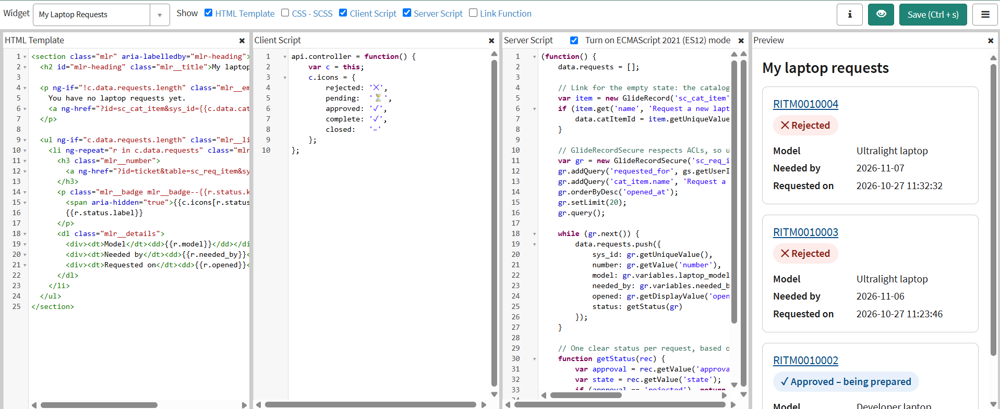
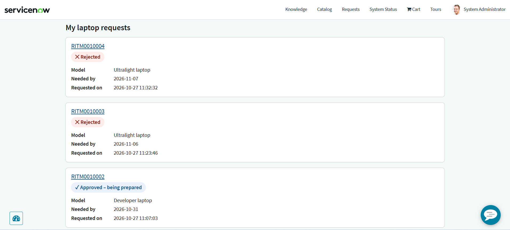
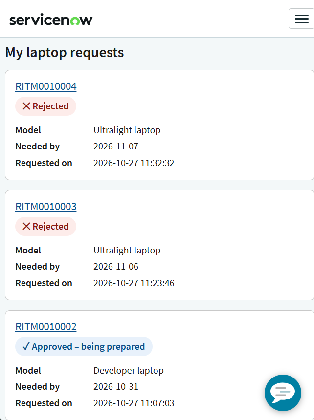
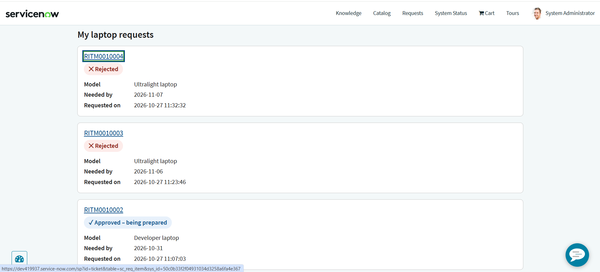
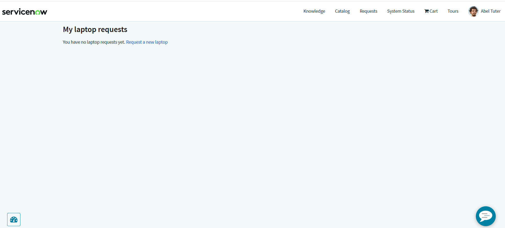
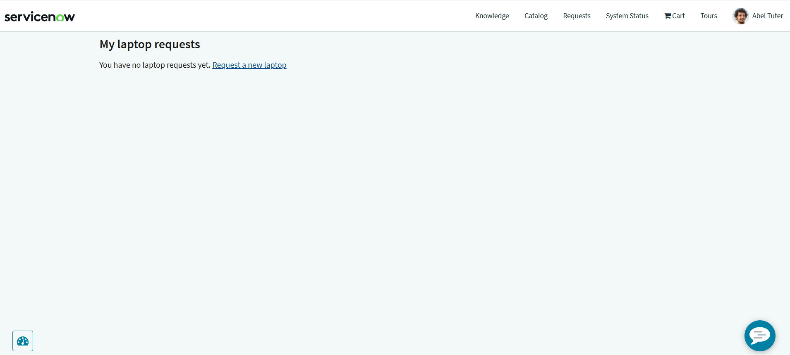
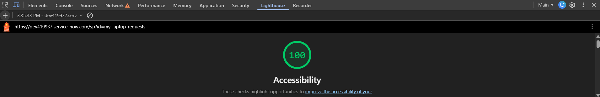
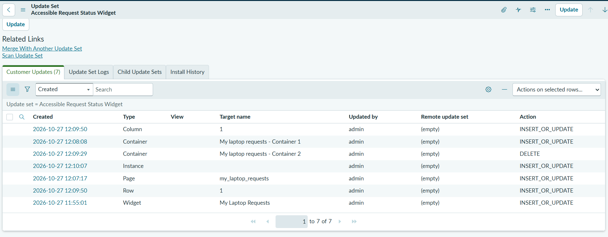

# Accessible Request Status Widget (ServiceNow Service Portal)

> Hands-on portfolio project built on my ServiceNow Personal Developer Instance
> (Australia release). Not production work.

## Business need
After employees order a laptop through the Service Catalog
([project 02](../02-hardware-request-catalog/)), they have no simple way to see
where their requests stand. The status they need is spread across the request,
its approval, and its state, in language written for IT staff.

## My role
Design, development, accessibility testing, and documentation (solo).

## User stories
1. **As an** employee, **I want** to see all my laptop requests and their status
   in plain language, **so that** I don't have to contact IT to check.
   - *Given* I have laptop requests, *then* each shows its number, model,
     needed-by date, request date, and one clear status.
   - *Given* I have no laptop requests, *then* I see a message and a link to
     request one.
2. **As an** employee who uses a keyboard or screen reader, **I want** the page
   to work with assistive technology, **so that** I can check my requests
   independently.
   - *Given* I navigate by keyboard, *then* every link is reachable and has a
     visible focus indicator.
   - *Given* I use a screen reader, *then* headings, the list, and each status
     are announced meaningfully, and decorative icons are not read out.

## Solution
A custom Service Portal widget, **My Laptop Requests**, on a new portal page
(`/sp?id=my_laptop_requests`).

### Server script ([`widget/server-script.js`](widget/server-script.js))
- Queries the logged-in user's requested items for the "Request a new laptop"
  catalog item, newest first
- Uses **`GlideRecordSecure`** rather than `GlideRecord`, so results respect
  access controls (ACLs)
- Reads the catalog variables (model, needed-by date) from each request
- Works out **one plain-language status** per request: Rejected, Waiting for
  manager approval, Approved – being prepared, Completed, or Closed

**Design decision:** the status checks the **approval first**, then the state.
RITM0010003 closed as "Complete" because of a bug found in project 02, but its
approval was rejected. The widget still correctly shows it as **Rejected**.

### Template ([`widget/template.html`](widget/template.html))
- A `<section>` labelled by its heading (`aria-labelledby`)
- An `<h2>` page heading, and an `<h3>` link for each request, so screen reader
  users can jump between requests by heading
- A `<ul>` list of cards, announced as "list, 3 items"
- A `<dl>` description list for the details, so each label is read with its value
- Status shown as **text**, not color alone, with decorative icons hidden from
  screen readers using `aria-hidden="true"`
- An empty state with a link to the catalog item

### Styles ([`widget/style.css`](widget/style.css))
- Badge colors chosen to meet WCAG AA contrast
- A 3px visible focus outline on links (`:focus-visible`)
- Underlined links, so they don't rely on color alone
- Single-column card layout that reflows on small screens

### Client controller ([`widget/client-controller.js`](widget/client-controller.js))
- Maps each status to a decorative icon

## Issues found and fixed
1. **Theme overrode text color.** The portal theme rendered the heading in light
   grey, which risked failing contrast. I scoped the widget's selectors
   (`.mlr .…`) so its own colors take priority.
2. **Text rendered too small.** Service Portal is built on Bootstrap 3, which
   sets the root font size to 10px, so my `rem` sizes came out around 11px.
   I switched to `px`, giving 16–18px text that still scales with browser zoom.
3. **Empty-state link relied on color alone.** The "Request a new laptop" link
   wasn't underlined and used the theme's lighter blue, which can fail WCAG
   1.4.1 (Use of Color). I underlined it and darkened it, then retested.

## Accessibility testing
| Test | Method | Result |
|------|--------|--------|
| Keyboard navigation | Tab through the page with no mouse | Pass: every link reachable in a logical order, visible focus outline, Enter opens the request |
| Skip link | Tab → Enter on "Skip to main content" → Tab | Pass: focus lands on the first request (portal feature, verified) |
| Screen reader | Windows Narrator | Pass: heading levels, "list, 3 items," status read as words, icons silent. Sample: *"Heading level 3, link, RITM0010004. Rejected. Model, Ultralight laptop…"* |
| Color contrast | Lighthouse contrast audit | Pass |
| ARIA usage | Lighthouse ARIA audit | Pass: only permitted ARIA attributes |
| Zoom and reflow | Browser zoom at 200% and 400% | Pass: no clipping, overlap, or horizontal scrolling |
| Mobile layout | Narrow viewport | Pass: cards stack cleanly |
| Empty state | Impersonated a user with no requests | Initially failed (link relied on color); **fixed and passed** |
| Automated scan | Lighthouse accessibility | **100** |

Automated tools catch only a portion of accessibility issues, so I paired
Lighthouse with manual keyboard, screen reader, and zoom testing.

**Observations outside the widget:** the portal's chat button overlaps the last
card on small screens. That's a portal-wide element, noted for the portal team.

## Functional testing
| Test | Expected | Result |
|------|----------|--------|
| Requester with 3 requests | Shows RITM0010004 and RITM0010003 as Rejected, RITM0010002 as Approved – being prepared, newest first | Pass |
| User with no requests (Abel Tuter) | Empty-state message and link; none of another user's requests shown | Pass |
| Request link | Opens the request's ticket page in the portal | Pass |
| Empty-state link | Opens the laptop request form | Pass |

## Configured vs. custom
| Component | Type | Why |
|-----------|------|-----|
| Portal page and layout | Configuration | Built in Page Designer |
| My Laptop Requests widget | Custom | No out-of-box widget combined this status logic, catalog variables, and the accessibility requirements |

## Update set
All work was captured in the **Accessible Request Status Widget** update set
(Global scope, 7 changes) and exported as XML:
[`accessible-request-widget-update-set.xml`](accessible-request-widget-update-set.xml)

It contains the widget, the page, and its layout records (container, row,
column, widget instance). One entry is a **DELETE** for an extra container I
added and then removed in Page Designer.

## Screenshots

### The widget
**Widget Editor: code and preview**

**Live portal page**

**Mobile view**

### Accessibility
**Visible keyboard focus**

**Empty state before the fix: link relied on color**

**Empty state after the fix**

**Lighthouse accessibility score**

**Lighthouse contrast audit passed**

### Update set

## What I'd do next
- Show all of a user's catalog requests, not only laptops, with a filter
- Add an "Updated" timestamp and a link to cancel pending requests
- Move the status logic into a Script Include so other widgets can reuse it
- Add ATF tests for the widget's server script
- Test with NVDA and on a mobile screen reader (TalkBack or VoiceOver)
